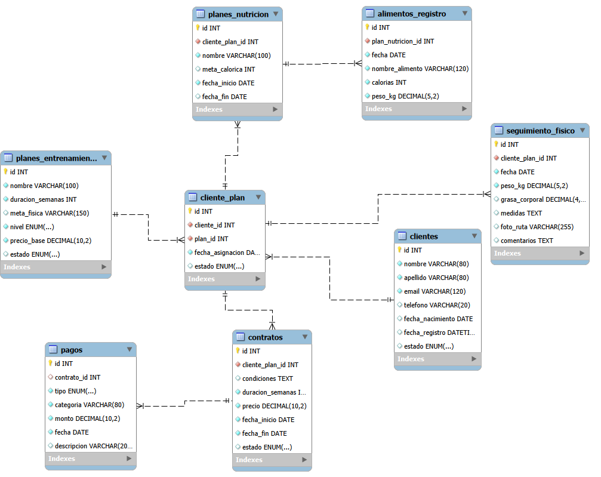

# 🏋️ VinSel Gym Manager

Aplicación de línea de comandos (CLI) en Node.js para que un entrenador personal gestione clientes, planes de entrenamiento, contratos, seguimiento físico, nutrición y finanzas de su gimnasio.

## 📋 Descripción del proyecto

VinSel Gym Manager permite registrar clientes, asignarles planes de entrenamiento con generación automática de contrato, dar seguimiento a su progreso físico, gestionar su alimentación y controlar los ingresos y egresos del negocio — todo desde una interfaz de consola interactiva construida con `inquirer` y `chalk`.

El proyecto está desarrollado en Node.js aplicando Programación Orientada a Objetos, principios SOLID y los patrones de diseño Repository y Factory, con persistencia en MySQL usando transacciones reales para garantizar la consistencia de los datos en operaciones críticas.

## Exportación del progreso de un cliente

En el menú principal, seleccione **Exportar progreso de cliente** e ingrese el ID o el nombre/apellido. Si la búsqueda por nombre coincide con varias personas, la CLI permite seleccionar el cliente correcto.

La aplicación crea `exports/` si aún no existe y escribe un archivo con el formato `cliente_<nombre>_<apellido>_progreso.json`. El JSON incluye los datos del cliente, sus planes de entrenamiento y contratos, avances físicos, y planes nutricionales con alimentos agrupados por día y su total de calorías estimadas.

## ⚙️ Instalación y uso

### Requisitos previos
- Node.js v18 o superior
- MySQL 8 (o compatible) corriendo localmente

### Pasos

1. Clona el repositorio:
```bash
   git clone https://github.com/lemical07/vinsel-gym-manager.git
   cd vinsel-gym-manager
```

2. Instala las dependencias:
```bash
   npm install
```

3. Configura las variables de entorno — copia la plantilla y completa tus credenciales reales:
```bash
   cp .env.example .env
```

Edita `.env` con tus datos de conexión a MySQL:

```
    DB_HOST=localhost
    DB_USER=tu_usuario
    DB_PASSWORD=tu_password
    DB_NAME=gimnasio_cli
    DB_PORT=3306
```


4. Crea la base de datos y sus tablas ejecutando el script en MySQL Workbench (o el cliente MySQL de tu preferencia):

```bash
   mysql -u tu_usuario -p < schema.sql
```

5. Ejecuta la aplicación:
```bash
   node index.js
```

## 📁 Estructura del proyecto

````
vinsel-gym-manager/
├── commands/                          # Interacción con el usuario vía inquirer/chalk — únicos archivos que muestran menús
│   ├── asignacion.command.js          # Menú: crear/listar/cancelar/renovar/finalizar asignación cliente-plan + contrato
│   ├── clientes.command.js            # Menú: crear/listar/actualizar/eliminar clientes
│   ├── menuPrincipal.js               # Menú raíz — banner de bienvenida/despedida, navega hacia los demás menús
│   ├── nutricion.command.js           # Menú: crear plan de alimentación, registrar alimentos, reporte, editar
│   ├── pago.command.js                # Menú: registrar ingresos/egresos, balance por fecha/cliente, editar pago
│   ├── planes.command.js              # Menú: crear/listar/actualizar/eliminar planes de entrenamiento
│   └── seguimiento.command.js         # Menú: registrar avance semanal, ver progreso, eliminar registro
├── config/
│   └── database.js                    # Pool de conexión a MySQL (mysql2/promise) + validación de variables de entorno
├── docs/                               # Documentación adicional exigida por el enunciado
│   ├── pdf/
│   │   └── planeacion-scrum.pdf       # Roles, sprints e historias de usuario, según plantilla del profesor
│   └── img/
│       └── diagrama-er.png            # Diagrama entidad-relación exportado desde MySQL Workbench
├── factories/                          # Patrón Factory — arma objetos válidos desde datos crudos de inquirer
│   ├── ClienteFactory.js
│   ├── ContratoFactory.js
│   ├── NutricionFactory.js
│   ├── PagoFactory.js
│   ├── PlanClienteFactory.js
│   ├── PlanFactory.js
│   └── SeguimientoFisicoFactory.js
├── models/                             # Entidades con validaciones por campo (tipo, requerido, formato, rango)
│   ├── AlimentoRegistro.js
│   ├── Cliente.js
│   ├── ClientePlan.js                 # Tabla puente que resuelve la relación N:M cliente↔plan
│   ├── Contrato.js
│   ├── Pago.js
│   ├── PlanEntrenamiento.js
│   ├── PlanNutricion.js
│   └── SeguimientoFisico.js
├── repositories/                       # Patrón Repository — única capa con acceso directo a MySQL (SQL vive solo aquí)
│   ├── ClientePlanRepository.js
│   ├── ClienteRepository.js
│   ├── ContratoRepository.js
│   ├── NutricionRepository.js
│   ├── PagoRepository.js
│   ├── PlanRepository.js
│   └── SeguimientoRepository.js
├── services/                           # Lógica de negocio y orquestación — aquí viven las transacciones reales
│   ├── AsignacionService.js            # Transacción: crear contrato automático / cancelar / renovar / finalizar
│   ├── ClienteService.js
│   ├── NutricionService.js
│   ├── PagoService.js
│   ├── PlanService.js
│   └── SeguimientoService.js          # Transacción: eliminar con protección del historial mínimo
├── utils/
│   └── consola.js                     # Helper para hipervínculos clickeables en consola (fotos de seguimiento)
├── .env                                 # Credenciales reales de MySQL — NO se sube (está en .gitignore)
├── .env.example                        # Plantilla de variables de entorno, sin valores reales — sí se sube
├── .gitignore
├── index.js                             # Punto de entrada — solo carga dotenv e inicia menuPrincipal
├── package-lock.json
├── package.json
├── README.md
└── schema.sql                          # Script de creación de la base de datos y sus 8 tablas

````


La arquitectura sigue un flujo de capas unidireccional:
```
commands → services → factories → repositories → models / MySQL
```


Cada capa solo conoce a la inmediatamente inferior — por ejemplo, `commands` nunca ejecuta SQL directamente, y `models` nunca sabe que existe `inquirer`.

## 🗄️ Modelo de datos

El proyecto usa 8 tablas relacionales: `clientes`, `planes_entrenamiento`, `cliente_plan` (tabla puente que resuelve la relación N:M entre clientes y planes), `contratos`, `seguimiento_fisico`, `planes_nutricion`, `alimentos_registro` y `pagos`.



## 🧱 Principios SOLID aplicados

**Single Responsibility Principle (SRP)**
Cada clase tiene una única razón para cambiar. `ClienteRepository` solo se encarga de las consultas SQL de clientes; `ClienteService` solo orquesta la lógica de negocio (por ejemplo, verificar que un email no esté duplicado antes de crear); `clientes.command.js` solo maneja la interacción con la consola. Ninguna de las tres sabe cómo hacer el trabajo de las otras dos.

**Open/Closed Principle**
`AsignacionService` permite agregar nuevas transiciones de estado (`cancelar`, `renovar`, `finalizar`) sin modificar un único método `actualizar()` genérico y frágil — cada transición es un método independiente con su propia regla de negocio.

**Dependency Inversion Principle (DIP)**
Los `Services` dependen de la abstracción que ofrece cada `Repository` (sus métodos públicos: `crear`, `listar`, `buscarPorId`...), nunca de los detalles de MySQL directamente. Esto permitiría, en teoría, cambiar el motor de base de datos sin modificar una sola línea de los `Services`.

## 🎨 Patrones de diseño usados y dónde

**Repository** — en toda la carpeta `/repositories`. Aísla el acceso a MySQL del resto de la aplicación: ningún `Service` ni `Command` ejecuta SQL directamente, todos pasan por un método del Repository correspondiente (ej. `ClienteRepository.crear()`, `ContratoRepository.buscarPorId()`).

**Factory** — en toda la carpeta `/factories`. Centraliza la construcción de objetos a partir de datos crudos provenientes de `inquirer` (strings sin procesar), incluyendo conversiones necesarias como transformar un string de fecha en un objeto `Date` real antes de pasarlo al constructor del modelo (ej. `ContratoFactory.crear()`, `SeguimientoFisicoFactory.crear()`).

## 🔒 Consideraciones técnicas

**Transacciones reales de MySQL**, implementadas con `mysql2/promise` (`beginTransaction` / `commit` / `rollback`), en las siguientes operaciones críticas:

- `AsignacionService.asignarPlan()` — crea la asignación cliente-plan y su contrato en una sola unidad atómica; si falla la creación del contrato, se revierte también la asignación.
- `AsignacionService.cancelar()` / `renovar()` / `finalizar()` — actualizan el estado de la asignación y su contrato de forma conjunta, evitando que un plan cancelado quede con un contrato activo (o viceversa).
- `SeguimientoService.eliminar()` — verifica dentro de la misma transacción que no se elimine el único registro de seguimiento de un plan, protegiendo el historial mínimo del cliente.

**Validaciones por capas:** cada modelo en `/models` valida tipo de dato, campos requeridos, formato (ej. email) y rangos (ej. edad entre 12 y 100 años) directamente en su constructor, antes de que el dato llegue a la base de datos. La unicidad de datos (ej. email de cliente) se valida en la capa de `Service`, ya que requiere consultar el estado actual de la base de datos, algo que el modelo no puede hacer por sí solo.

## 🎥 Video explicativo

[Ver video explicativo](https://drive.google.com/drive/folders/1sfF0Age3oCMTBCs-dDfBK6pEBt-0VfMC?usp=sharing)

## 📅 Planeación Scrum

La planeación del proyecto (roles, sprints, historias de usuario) se gestionó en ClickUp y se documenta en el PDF adjunto siguiendo la plantilla proporcionada:


[Ver documento de planeación Scrum](https://docs.google.com/document/d/1mMKomV3y2x2r01b0_GAREzCbcYxsropwV5ycpb1CqBA/edit?usp=sharing)

## 👤 Créditos

Desarrollado por — [Lem Ical](https://github.com/lemical07)

Proyecto individual, desarrollado como parte de la formación en Desarrollador FullStack.