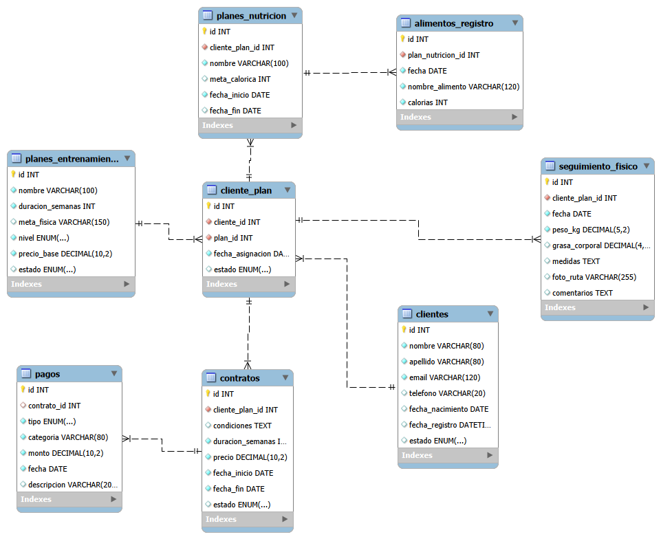

# VinSel Gym Manager


````
vinsel-gym-manager/
├── .env 
├── .env.example
├── .gitignore
├── package.json
├── README.md
├── schema.sql
├── index.js                      -> menú principal del CLI
├── config/
│ └── database.js
├── docs/
│ └── diagrama-er.png                  
├── models/
│ ├── Cliente.js
│ ├── PlanEntrenamiento.js
│ ├── Contrato.js
│ ├── SeguimientoFisico.js
│ ├── PlanNutricion.js
│ ├── AlimentoRegistro.js
│ └── Pago.js
├── repositories/                   ->patrón Repository
│ ├── Repository.js 
│ ├── ClienteRepository.js
│ ├── PlanRepository.js
│ ├── ContratoRepository.js
│ ├── SeguimientoRepository.js
│ ├── NutricionRepository.js
│ └── PagoRepository.js
├── factories/ (patrón Factory)
│ ├── ClienteFactory.js
│ ├── ContratoFactory.js
│ └── PlanFactory.js
├── services/                        ->lógica de negocio, incluye las transacciones
│ ├── ClienteService.js
│ ├── PlanService.js
│ ├── ContratoService.js
│ ├── SeguimientoService.js
│ ├── NutricionService.js
│ └── FinanzasService.js
├── commands/                         ->interacción con inquirer/chalk
│ ├── menuPrincipal.js
│ ├── clientes.command.js
│ ├── planes.command.js
│ ├── seguimiento.command.js
│ ├── nutricion.command.js
│ └── finanzas.command.js
└── utils/
└── validators.js
````